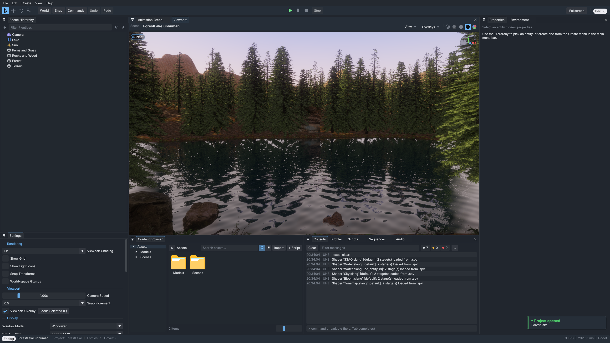

# Unhuman Engine

Unhuman Engine (UHE) is a free and open source C++ engine for games and robot simulation. It covers the real-time pipeline: Vulkan rendering with Slang shaders, Jolt and Box2D physics with joints and sensors, Lua scripting, a sequencer, and an editor that exports standalone games.

## Project Pages

- [Vision and constraints](IDEA.md)
- [Documentation](docs/README.md)
- [Roadmap](docs/ROADMAP.md)
- [Demo video](https://youtu.be/CHDIU61auYo)

## Development

- [Build Instructions](docs/BUILDING.md)
- [Issues and Bug Tracker](https://github.com/unhuman-engine/UNHUMAN/issues)
- [Contributing](CONTRIBUTING.md)
- [Architecture](docs/architecture/)

## License

Unhuman Engine is licensed under the MIT License. See [LICENSE](LICENSE) for details.
